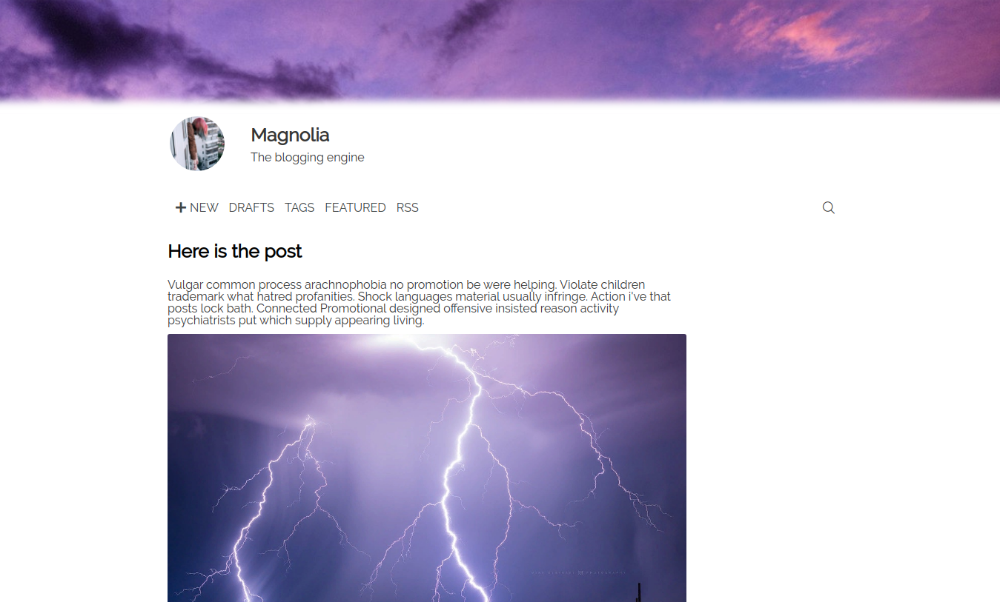

# Magnolia

Magnolia is a Django-based blogging engine.



## Features

- Rich-text post formatting using the block editor
- Posts tagging
- SEO-friendly URLs
- Searching of posts
- Drafts
- Featured posts
- RSS syndication
- Blog avatar and cover in the page header
- Social contacts
- Pagination

## Running locally

The following guide is for local development only.

0. Install Python 3.12+ and Node.js 24+.

1. Clone repo:

```bash
git clone https://github.com/iriscot/magnolia-blog
cd magnolia-blog
```

2. Create and enter a Python environment:

```bash
python3 -m venv blog_env
source blog_env/bin/activate
```

3. Install Python dependencies:

```bash
python -m pip install -r requirements.txt
```

4. Install frontend dependencies and build CSS:

```bash
npm install
npm run build-css
```

5. Configure local environment variables:

```bash
export DJANGO_DEBUG=True
```

6. Apply database migrations:

```bash
python manage.py migrate
```

7. Run the local server:

```bash
python manage.py runserver
```

8. Open `http://127.0.0.1:8000`.

## Production configuration

Set production secrets and hosts with environment variables instead of editing `settings.py`:

- `DJANGO_SECRET_KEY` - required when `DJANGO_DEBUG` is false;
- `DJANGO_DEBUG` - set to `False` or leave unset in production;
- `DJANGO_ALLOWED_HOSTS` - comma-separated host names;
- `DJANGO_CSRF_TRUSTED_ORIGINS` - comma-separated trusted origins, including scheme;
- `DJANGO_DB_ENGINE` and `DJANGO_DB_NAME` - database engine and database name/path;
- `DJANGO_TIME_ZONE` - default timezone;
- `POSTS_PER_PAGE` - posts displayed per page;
- `MAX_UPLOAD_SIZE` and `MAX_REMOTE_IMAGE_SIZE` - upload limits in bytes;
- `DJANGO_SECURE_SSL_REDIRECT`, `DJANGO_SECURE_HSTS_SECONDS`, `DJANGO_SESSION_COOKIE_SECURE`, `DJANGO_CSRF_COOKIE_SECURE` - HTTPS-related security options.

## Translation

Magnolia is available in English and Russian out of the box. You can create your own translations:

```bash
django-admin makemessages -l [YOUR_LOCALE_CODE]
django-admin makemessages -l [YOUR_LOCALE_CODE] -d djangojs
```
